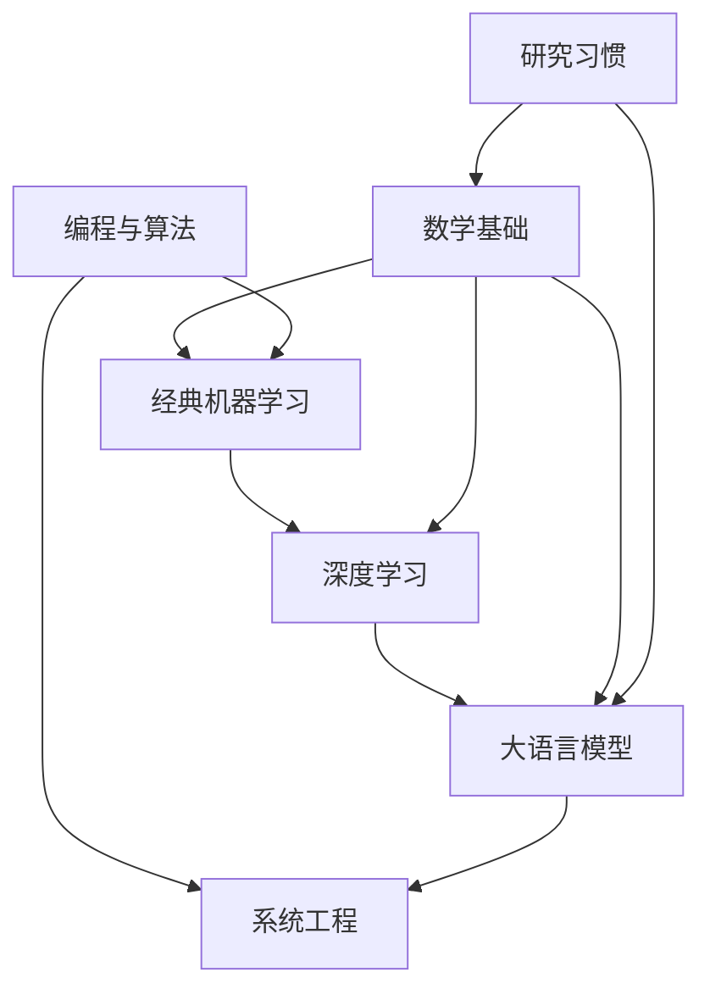

# 路线图

各阶段的子主题、依赖和完成标准都在这里。完成与否看下面列出的能力。

状态有两种：

- **笔记已写**：已有笔记，可以开始读。
- **地图**：顺序和完成标准已经定了，这一篇还没有笔记。

## 怎样安排顺序

数学和编程可以同时开始。经典机器学习依赖这两者的基础。深度学习依赖经典机器学习的问题框架和链式法则。语言模型依赖深度学习，并把条件概率的分解当成日常语言。系统工程从第一条训练循环开始，和语言模型的后半段并行。读论文从第一周就开始。

| 顺序 | 做什么 | 可以开始的条件 |
| --- | --- | --- |
| 同时 | [线性代数](../02-数学基础/01-线性代数.md) 与 [复杂度](../03-编程与算法/01-复杂度与不变量.md) | 会基本 Python |
| 同时 | [怎样读论文](../08-研究习惯/01-怎样读一篇论文.md)，对一篇先读材料做第一遍 | 无 |
| 接着 | [概率](../02-数学基础/02-概率.md) 里的条件、期望、极大似然；[哈希、堆与搜索模式](../03-编程与算法/02-哈希堆与搜索模式.md) | 线性代数开篇和复杂度开篇的练习做完 |
| 接着 | [统计](../02-数学基础/03-统计.md)：估计量的偏差、方差、抽样，以及全量均值再划分 | [概率](../02-数学基础/02-概率.md) 的期望、方差和极大似然 |
| 接着 | [监督学习](../04-经典机器学习/01-监督学习的最小闭环.md) | 能写条件概率，能对简单函数求导 |
| 接着 | [泛化、正则与模型选择](../04-经典机器学习/02-泛化正则化与模型选择.md) | 能说出训练误差和验证误差各在哪一批样本上计算 |
| 接着 | [反向传播](../05-深度学习/01-计算图与反向传播.md) | 能把损失看成标量，会链式法则 |
| 接着 | [激活、初始化与归一化](../05-深度学习/03-激活初始化与归一化.md) | 能把手算网络的梯度写出来 |
| 接着 | [优化](../05-深度学习/02-优化.md)：SGD、动量、AdamW、warmup | 能对手算网络写出梯度 |
| 接着 | [Token 与下一个词](../06-大语言模型/01-Token与下一个词.md) | 能写出联合分布的链式分解 |
| 并行 | [训练一步](../07-系统工程/01-训练一步的数据流.md) 与 [自注意力](../06-大语言模型/02-自注意力与Transformer.md) | 知道标签要比输入超前一个位置 |
| 接着 | [预训练](../06-大语言模型/03-预训练.md)：数据、去重与 `6ND` | 能把损失写成被监督 token 上的平均负对数概率 |
| 接着 | [对齐](../06-大语言模型/04-对齐.md)：SFT、奖励模型、PPO 与 DPO | 能把 SFT 的损失写成回答 token 上的平均负对数似然 |
| 接着 | [评估](../06-大语言模型/05-评估.md)：指标、排名、污染与区间 | 能设计一个小评估，并指出一种做高分数的办法 |
| 接着 | [检索增强生成](../06-大语言模型/06-检索增强生成.md)：切块、BM25 与向量检索、重排、提示中的上下文 | 能写出召回率@k，并指出一种不改正文也能把这个分数做高的办法 |
| 接着 | [最小可核对实验](../08-研究习惯/02-最小可核对实验.md)：主张、基线、推翻条件与 `6ND` | 能把准备依赖的论文指回原文，并会算 `C ≈ 6ND` |
| 持续 | 每个阶段至少把一篇核心论文读到能指回原文 | 按 [怎样读一篇论文](../08-研究习惯/01-怎样读一篇论文.md) 记下主张、假设和不确定的点 |

算法工程师在这里的意思是：能把一个预测或生成问题写成数据、模型、损失、更新和评估；能把实现里的形状、掩码和复杂度说清楚；能判断一项指标会被怎样做高。研究科学家的论文产出、后端工程师的服务框架，都不是这条路线的终点，但读论文和写正确的训练循环是这条路线的一部分。

## 数学基础

阶段说明与术语见 [02-数学基础](../02-数学基础/README.md)。

| 序号 | 主题 | 状态 | 笔记 |
| --- | --- | --- | --- |
| 1 | 向量、矩阵、秩、投影、特征值与 SVD | 笔记已写 | [线性代数](../02-数学基础/01-线性代数.md) |
| 2 | 概率：条件、期望、常用分布 | 笔记已写 | [概率](../02-数学基础/02-概率.md) |
| 3 | 统计：估计、偏差与方差、极大似然、抽样 | 笔记已写 | [统计](../02-数学基础/03-统计.md) |
| 4 | 优化：梯度、凸与非凸、一阶方法 | 地图 | |
| 5 | 信息论：熵、交叉熵、KL | 地图 | |

完成时你能：

- 把最小二乘写成矩阵问题，说明正规方程在列满秩时有唯一解，以及先形成 `AᵀA` 为什么会把条件数平方。
- 用条件概率把联合分布写成自回归分解。
- 对 Bernoulli 样本写出极大似然，并说明 Categorical 的平均负对数似然是经验分布和模型分布的交叉熵。
- 穷举一个两值总体的样本均值，写出偏差和方差，并说明全量均值再划分时估计量用了测试点、测试平方和会变小。
- 写出交叉熵等于熵加 KL。真实分布固定时，最小化交叉熵就是最小化 KL。
- 说明梯度下降在更新什么。目标非凸时，损失下降只说明这一步在下降，不说明找到了全局最好。
- 不看笔记重做本阶段已有练习。

这一阶段不追求：抽象向量空间的公理体系、测度论、凸优化全书证明、把信息论上成通信课。

## 编程与算法

阶段说明见 [03-编程与算法](../03-编程与算法/README.md)。

| 序号 | 主题 | 状态 | 笔记 |
| --- | --- | --- | --- |
| 1 | 复杂度、不变量、问题建模 | 笔记已写 | [复杂度与不变量](../03-编程与算法/01-复杂度与不变量.md) |
| 2 | 数组、哈希、栈、队列、堆 | 笔记已写 | [哈希、堆与搜索模式](../03-编程与算法/02-哈希堆与搜索模式.md) |
| 3 | 二分查找，以及在答案空间上二分 | 笔记已写 | [哈希、堆与搜索模式](../03-编程与算法/02-哈希堆与搜索模式.md) |
| 4 | 双指针、滑动窗口、前缀和 | 笔记已写 | [哈希、堆与搜索模式](../03-编程与算法/02-哈希堆与搜索模式.md) |
| 5 | 树、图遍历、拓扑排序 | 地图 | |
| 6 | 最短路与并查集 | 地图 | |
| 7 | 动态规划：先定义状态 | 地图 | |
| 8 | 测试、边界与数值细节 | 地图 | |

开篇笔记里已经有一张模式地图。后面的笔记负责把每一种模式的不变量和测试写完整，而不是收集题单。

完成时你能：

- 看到约束后先估算复杂度是否够用。
- 独立写出并测试二分、在答案上的二分、双指针、BFS、简单 DP 和堆。
- 讲出循环不变量，而不是只记得代码的形状。
- 积累大约 40 道自己做对、隔周还能重写的题，覆盖上面的模式。40 是下限，不是目标。
- 把一段算法的失败情况写成测试。训练代码里的 off-by-one 用同一习惯处理。

这一阶段不追求：把题库刷完、比赛技巧、过早的常数级优化。

## 经典机器学习

阶段说明见 [04-经典机器学习](../04-经典机器学习/README.md)。

| 序号 | 主题 | 状态 | 笔记 |
| --- | --- | --- | --- |
| 1 | 经验风险、逻辑回归、指标与泄漏 | 笔记已写 | [最小闭环](../04-经典机器学习/01-监督学习的最小闭环.md) |
| 2 | 线性回归：闭式解与梯度下降 | 地图 | |
| 3 | 偏差、方差与正则 | 笔记已写 | [泛化、正则与模型选择](../04-经典机器学习/02-泛化正则化与模型选择.md) |
| 4 | 决策树与集成 | 地图 | |
| 5 | 概率预测与校准 | 地图 | |
| 6 | 无监督：PCA 与聚类 | 地图 | |

完成时你能：

- 为一个具体问题选择指标，并举出准确率会误导的数据分布。
- 从零推一遍二元逻辑回归的损失和它对 logit 的梯度。
- 在一个数据管道里指出泄漏，包括用全量数据做归一化。
- 说明 L2 正则同时改变了目标和参数的大小。
- 用平方损失把固定输入上的期望预测误差拆成噪声、偏差的平方和方差。
- 在两个 `λ` 之间用验证误差选择，并且不因为测试集更喜欢另一个 `λ` 就改选择。

这一阶段不追求：把每一种经典模型的推导都写全再进入深度学习。树和集成是地图的一部分，因为工作中仍然会碰到表格数据和强基线。

## 深度学习

阶段说明见 [05-深度学习](../05-深度学习/README.md)。

| 序号 | 主题 | 状态 | 笔记 |
| --- | --- | --- | --- |
| 1 | 计算图与反向传播 | 笔记已写 | [反向传播](../05-深度学习/01-计算图与反向传播.md) |
| 2 | 多层感知机、激活与初始化 | 笔记已写 | [激活、初始化与归一化](../05-深度学习/03-激活初始化与归一化.md) |
| 3 | 批量、学习率、动量与 Adam | 笔记已写 | [优化](../05-深度学习/02-优化.md) |
| 4 | 权重衰减、dropout、早停 | 地图 | |
| 5 | 嵌入 | 地图 | |
| 6 | 归一化与残差上的梯度路径 | 笔记已写 | [激活、初始化与归一化](../05-深度学习/03-激活初始化与归一化.md) |
| 7 | 卷积与循环网络作为背景 | 地图 | |

完成时你能：

- 手算一个小网络的梯度，并用有限差分核对。
- 看懂一层的输入、权重和输出形状，并使用 [记号约定](../记号约定.md) 里的线性层形状。
- 写出残差 `y = x + f(x)` 对 `x` 的导数为什么还留着一条直通路径。
- 说明 BatchNorm 依赖批内统计，LayerNorm 对单个样本的特征做归一化，RMSNorm 不减均值。
- 对给定的 `fan_in`、`fan_out` 写出 Xavier 和 ReLU 的 He 均匀边界，并说明 sigmoid 的导数不超过 `1/4`。
- 用同一组数手算一步带动量的 SGD 和一步带偏差修正的 Adam，并说明 AdamW 的权重衰减加在参数上，不进入矩估计。

这一阶段不追求：把 CNN 和 RNN 学到能当主线。它们用来理解注意力出现之前序列模型的计算方式。

## 大语言模型

阶段说明和术语见 [06-大语言模型](../06-大语言模型/README.md)。这是路线的核心，子主题因此列得更细。模型预测下一个 token；嵌入、正弦位置和自注意力组成一次 decoder-only 前向。RMSNorm 的计算在 [激活、初始化与归一化](../05-深度学习/03-激活初始化与归一化.md)。RoPE、SwiGLU、GQA 仍是单独的结构主题。

| 序号 | 主题 | 状态 | 笔记 |
| --- | --- | --- | --- |
| 1 | Token 与下一个词的概率 | 笔记已写 | [开篇](../06-大语言模型/01-Token与下一个词.md) |
| 2 | 嵌入与位置信息 | 笔记已写 | [自注意力与 Transformer 块](../06-大语言模型/02-自注意力与Transformer.md) |
| 3 | Attention 与 Transformer 块 | 笔记已写 | [自注意力与 Transformer 块](../06-大语言模型/02-自注意力与Transformer.md) |
| 4 | 解码器结构，以及 RoPE、RMSNorm、SwiGLU、GQA | 地图 | |
| 5 | 预训练数据与扩展规律 | 笔记已写 | [预训练](../06-大语言模型/03-预训练.md) |
| 6 | 对齐：SFT、RLHF / PPO、DPO | 笔记已写 | [对齐](../06-大语言模型/04-对齐.md) |
| 7 | 评估 | 笔记已写 | [评估](../06-大语言模型/05-评估.md) |
| 8 | RAG | 笔记已写 | [检索增强生成](../06-大语言模型/06-检索增强生成.md) |
| 9 | 智能体 | 地图 | |
| 10 | 推理、解码与服务 | 地图 | |
| 11 | 数据侧：去重、配比、合成数据 | 笔记已写 | [预训练](../06-大语言模型/03-预训练.md) |

完成时你能：

- 讲清 decoder-only Transformer 的一次前向：形状、因果掩码、损失落在哪些位置。
- 说明 SFT 使用示范回答，偏好优化使用同一提示下的优劣比较；DPO 去掉了单独的奖励模型和强化学习循环，训练时仍然要参考模型的对数概率。
- 设计一个小评估，并指出一种可以投机取巧做高分数的办法。
- 对一小批文档手算余弦和 BM25 的排序，写出召回率@k，并说明切块、近似最近邻和上下文预算怎样把已经检索到的证据挡在提示外面。
- 说明 KV cache 在精确算术下与重算历史相同，省下的是重复计算，占用的是随上下文增长的显存。
- 做完概念练习。跑通别人的笔记本不算完成。
- 用 `C ≈ 6ND` 估算训练浮点量，并说明注意力的二次项和输出投影在什么时候不能从这笔账里删掉。

这一阶段不追求：追每一个新模型的发布说明。架构组件先要求认得动机，再在对应笔记里写公式。

## 系统工程

阶段说明见 [07-系统工程](../07-系统工程/README.md)。

| 序号 | 主题 | 状态 | 笔记 |
| --- | --- | --- | --- |
| 1 | 训练一步的数据流 | 笔记已写 | [训练一步](../07-系统工程/01-训练一步的数据流.md) |
| 2 | 实验记录，以及可复现的边界 | 地图 | |
| 3 | 分布式训练：数据并行、张量并行、流水线并行、ZeRO | 地图 | |
| 4 | 推理优化：KV cache、批处理、量化 | 笔记已写 | [推理优化](../07-系统工程/02-推理优化.md) |
| 5 | 观测：训练曲线、线上延迟与质量 | 地图 | |

开篇已经列出一次实验至少要记下的字段。实验记录来自一次真实运行，不编造没有跑过的曲线。

完成时你能：

- 画出自己的训练步，标出哪些张量可以在不反传的情况下检查。
- 说明数据并行把有效批量变成各卡批量之和，梯度按卡平均；学习率要不要随批量线性放大，用损失曲线核对，不靠口号。
- 列出上线一个生成模型时要看的质量指标和系统指标。质量至少包括任务本身的对错，系统至少包括首 token 时间和生成速度。
- 留下一次实验记录，使另一个人能按记录讨论。数据不能公开时，记录里写明缺的是哪一部分。

## 研究习惯

阶段说明见 [08-研究习惯](../08-研究习惯/README.md)。

| 序号 | 主题 | 状态 | 笔记 |
| --- | --- | --- | --- |
| 1 | 怎样读一篇论文 | 笔记已写 | [方法](../08-研究习惯/01-怎样读一篇论文.md) |
| 2 | 最小可核对实验 | 笔记已写 | [最小核对](../08-研究习惯/02-最小可核对实验.md) |
| 3 | 入门阅读清单 | 笔记已写 | [阅读清单](../08-研究习惯/阅读清单.md) |

完成时你能：

- 按 [怎样读一篇论文](../08-研究习惯/01-怎样读一篇论文.md) 写至少 3 篇笔记。每篇用自己的话概括主张、关键假设，以及不确定的点。
- 从一篇论文写出可以核对的最小实验，并写明算力边界。写法见 [最小可核对实验](../08-研究习惯/02-最小可核对实验.md)。
- 把清单里标为先读的材料亲自读过。
