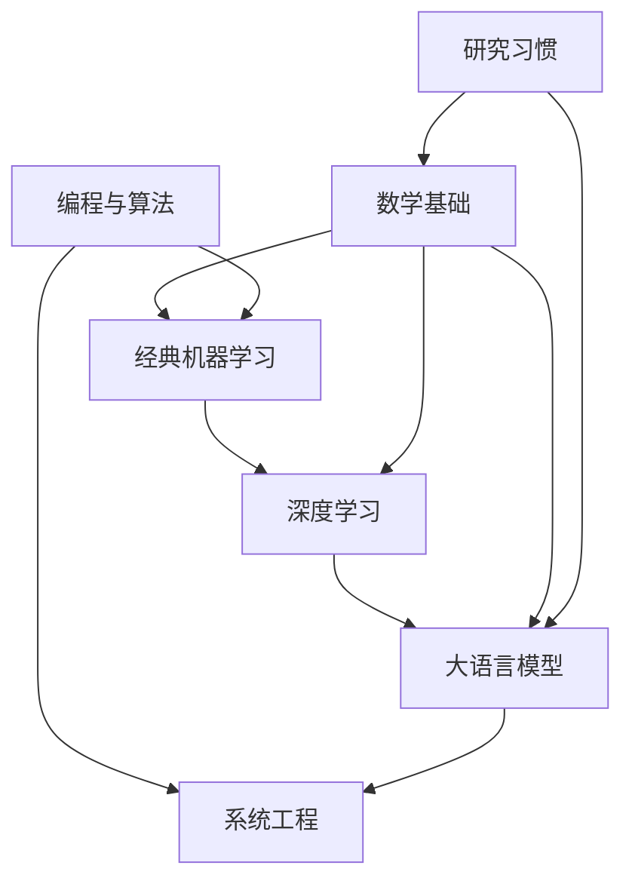

# LLM-Learning

**仓库描述：** 个人算法工程师课程：数学、算法、机器学习与大语言模型，持续更新的学习笔记。

若 GitHub 的 About 仍是空的，把上一句填进去即可。除此之外，本仓库不改动仓库设置。

这是一份给自己用的长期课程，目标是成为优秀的算法工程师。大语言模型是后面的主线，前面的数学、编程、经典机器学习和系统能力按真正要动手做模型的深度来学，而不是按学科目录铺开。

语言以简体中文为主。Transformer、attention、softmax、token、PPO、DPO、RAG 这些词用它们通常的英文名字。

## 这个仓库里有什么

- 一条可以从今天开始的路线：每个阶段有前置、建议顺序和完成标准。
- 每个主要阶段的开篇笔记，里面有定义、手算例子和练习。
- 统一的笔记、练习和论文笔记格式，后面加章节时不用改目录结构。
- 一份带用途说明的阅读清单。链接集中登记在那里。

手算例子由 [`tools/check_worked_examples.py`](tools/check_worked_examples.py) 复核。

```bash
python3 tools/check_worked_examples.py
```

## 边界

- 算法部分练的是复杂度和不变量。代表题用来练习，个人题解不放进仓库。
- 外部材料进阅读清单，并写明它在路线里的用途。正文是可以单独读的原创说明。
- 不转载教材章节、课程讲稿和付费论文。
- 不提供公开许可证。见 [所有权说明](所有权说明.md)。

## 从今天开始

1. 读本页的路线图，选一个阶段，只打开状态是「笔记已写」的那一篇。地图里其余行是以后的顺序，不是欠着的作业。
2. 先看该篇「本篇要回答的问题」，试着自己答，再读正文，最后做折叠解答上面的练习。
3. 用 [学习日志模板](00-使用与维护/学习日志模板.md) 记下卡住的那一题。
4. 第一周就可以并行做三件小事：线性代数开篇、复杂度开篇，以及用 [怎样读一篇论文](08-研究习惯/01-怎样读一篇论文.md) 对阅读清单里的一篇「先读」材料做第一遍。

记号（线性层形状、标签怎么错位、对数用 ln）写在 [记号约定](00-使用与维护/记号约定.md)。后面的笔记都按它来。

## 路线图

建议顺序不是把上一阶段百分之百读完才允许看下一阶段。每一篇开头写了自己的前置。下面是依赖关系：数学和编程可以同时开始；经典机器学习吃两者的基础；深度学习吃经典机器学习的问题框架和链式法则；语言模型吃深度学习，并把概率里的条件分解当成日常语言；系统工程从第一条训练循环开始，和语言模型后半段并行；读论文的习惯从第一周就开始。



| 阶段 | 前置 | 现在就能读 | 完成时是什么样 |
| --- | --- | --- | --- |
| [数学基础](02-数学基础/README.md) | 高中代数与坐标 | [线性代数](02-数学基础/01-线性代数.md) | 能把最小二乘、条件概率分解、交叉熵和梯度讲成同一套对象，并手算已有练习 |
| [编程与算法](03-编程与算法/README.md) | 能写基本 Python | [复杂度与不变量](03-编程与算法/01-复杂度与不变量.md) | 能按约束估算复杂度，用不变式写对基础模式，并有一批自己能隔周重写的代表题 |
| [经典机器学习](04-经典机器学习/README.md) | 点积、条件概率、导数 | [监督学习的最小闭环](04-经典机器学习/01-监督学习的最小闭环.md) | 能为一个预测问题选定损失和指标，指出数据泄漏，推完逻辑回归对 logit 的梯度 |
| [深度学习](05-深度学习/README.md) | 链式法则；知道损失是标量 | [计算图与反向传播](05-深度学习/01-计算图与反向传播.md) | 能手算或用有限差分核对小网络梯度，说清张量形状和残差上的梯度路径 |
| [大语言模型](06-大语言模型/README.md) | 条件概率、反向传播的形状意识 | [Token 与下一个词](06-大语言模型/01-Token与下一个词.md) | 能讲清一次解码器前向、对齐数据各自在优化什么，以及一项评估会被怎样钻空子 |
| [系统工程](07-系统工程/README.md) | 语言建模的标签约定 | [训练一步的数据流](07-系统工程/01-训练一步的数据流.md) | 能标出训练步里每个张量的含义，说清并行和推理优化各切哪一种资源，并留下可讨论的实验记录 |
| [研究习惯](08-研究习惯/README.md) | 无 | [怎样读一篇论文](08-研究习惯/01-怎样读一篇论文.md)、[阅读清单](08-研究习惯/阅读清单.md) | 用固定格式写过至少三篇论文笔记，清单里的先读材料亲自打开过 |

子主题、每个阶段故意不追求的内容，以及术语的短定义，写在 [路线图](01-路线图/README.md) 和各阶段 README 里。完成与否看上面的能力，不看日历。

## 目录

| 路径 | 内容 |
| --- | --- |
| [00-使用与维护](00-使用与维护/README.md) | 模板、记号、维护约定 |
| [01-路线图](01-路线图/README.md) | 全部阶段的子主题和完成标准 |
| [02-数学基础](02-数学基础/README.md) | 线性代数、概率、统计、优化、信息论 |
| [03-编程与算法](03-编程与算法/README.md) | 复杂度、数据结构、问题模式 |
| [04-经典机器学习](04-经典机器学习/README.md) | 监督、泛化、指标、泄漏 |
| [05-深度学习](05-深度学习/README.md) | 计算图、优化、表示 |
| [06-大语言模型](06-大语言模型/README.md) | 分词、Transformer、预训练、对齐、评估、RAG、推理 |
| [07-系统工程](07-系统工程/README.md) | 训练循环、分布式、推理、观测 |
| [08-研究习惯](08-研究习惯/README.md) | 读论文的方法和阅读清单 |
| [09-学习日志](09-学习日志/README.md) | 个人进度，第一版是空的 |
| [tools/check_worked_examples.py](tools/check_worked_examples.py) | 笔记数字和短参考实现的检查 |

## 以后怎样加内容

新笔记复制 [笔记模板](00-使用与维护/笔记模板.md)，放进已有阶段目录，用下一位序号命名。同时改两处状态：该阶段 README，以及路线图里的同一行。新链接登记进阅读清单。具体步骤在 [维护约定](00-使用与维护/维护约定.md)。

不把仓库改成另一种结构就能继续加：数学后面的概率、语言模型后面的 Transformer、系统后面的并行，都是阶段 README 里已经留好的行。
